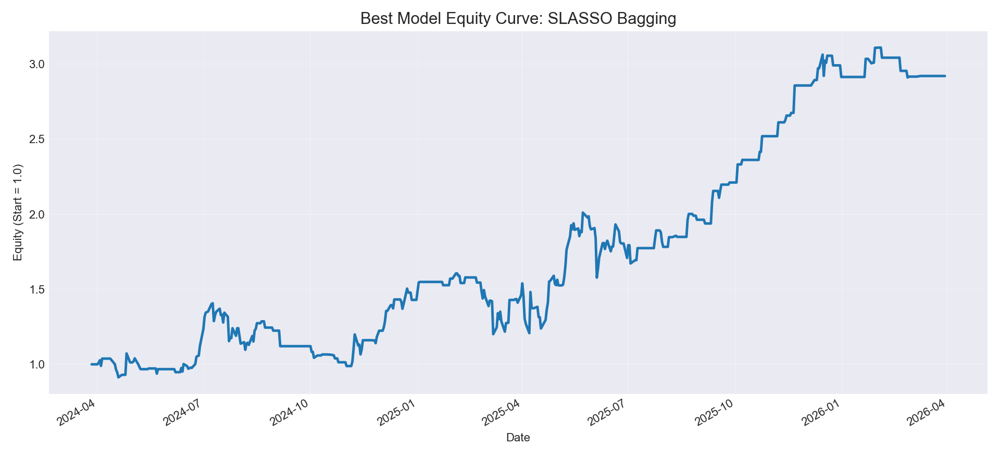
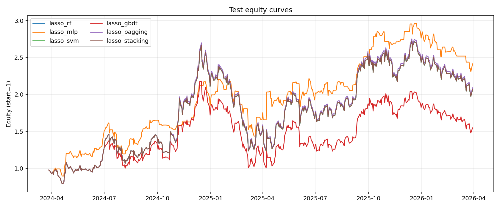
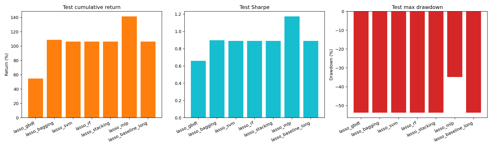
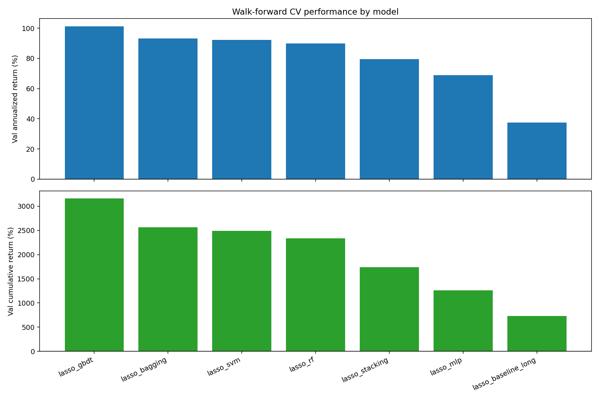
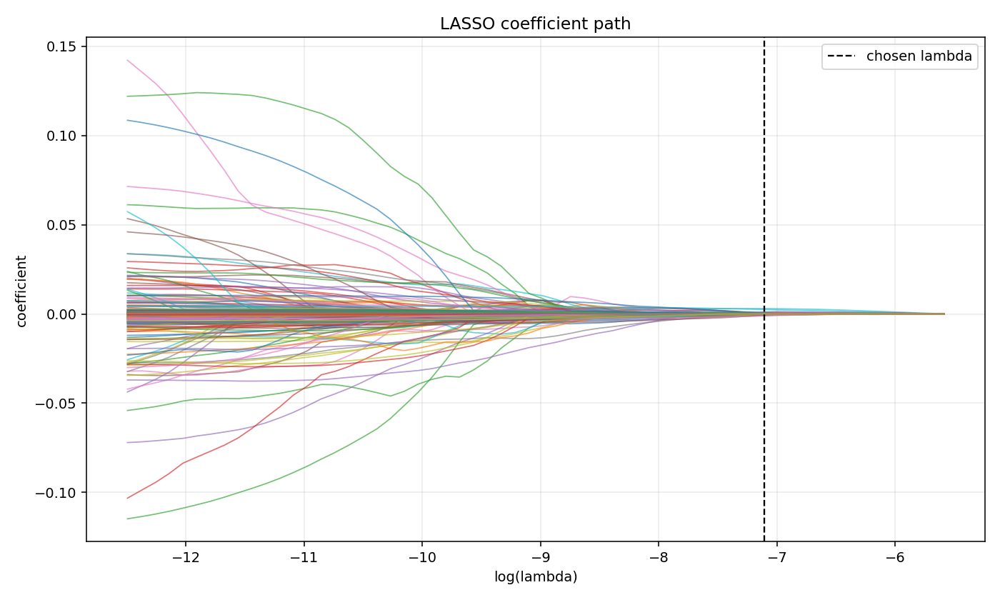
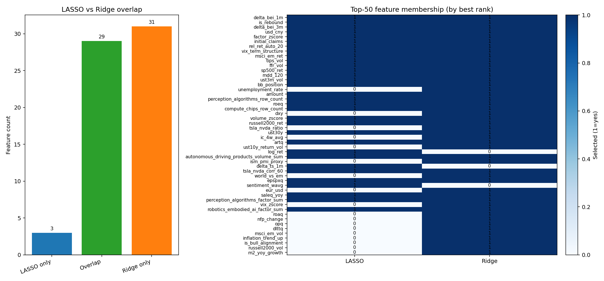
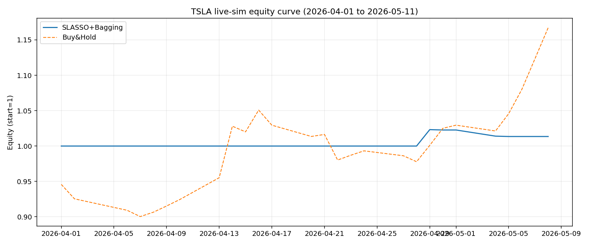

# Leveraging Machine Learning for Long-only Trading: Evidence from Tesla

A research-grade backtesting framework for timing a single stock (TSLA) with machine learning. It draws on 186 candidate factors (macro, fundamental, technical, and a FinBERT-based **AI narrative factor**), uses three feature selectors and six classifiers, evaluates strictly out of sample, and adds a forward live simulation.

📄 Full paper: [`paper/Leveraging_Machine_Learning_for_Long-only_Trading.pdf`](paper/Leveraging_Machine_Learning_for_Long-only_Trading.pdf)



## Highlights

- **Best model: SLASSO + Bagging.** On the holdout test window (2024-04 to 2026-03) it returned **192.1% cumulative**, with a **Sharpe ratio of 1.35** and a **max drawdown of −29.7%**. Buy-and-hold TSLA returned 106.5%, with a Sharpe of 0.89 and a max drawdown of −53.8%.
- **Stability selection matters.** Holding the learner fixed, SLASSO features beat LASSO and Ridge features. Switching Bagging from LASSO to SLASSO features adds about 83pp of cumulative return.
- **Complexity alone is not enough.** Several tuned models collapse to "always long" on the test set. Walk-forward validation winners such as LASSO-GBDT underperform on the holdout, which is direct evidence of model risk.
- **Live simulation (2026-04-01 to 2026-05-11).** The strategy returned +1.35%, with a Sharpe of 1.70 and a max drawdown of −0.95%. Buy-and-hold returned +16.7% over the same window. The model stayed flat for most of April, so it protected the downside but missed the rebound.

## Results

Holdout test set, long/flat. Each cell shows cumulative return / Sharpe ratio / max drawdown. Source: [`results/backtest/model_summary.csv`](results/backtest/model_summary.csv).

| Learner | LASSO | **SLASSO** | Ridge |
|---|---|---|---|
| Baseline (always long) | 106.5% / 0.89 / −53.8% | 106.5% / 0.89 / −53.8% | 106.5% / 0.89 / −53.8% |
| Random Forest | 106.5% / 0.89 / −53.8% | 163.8% / 1.23 / −31.9% | 106.5% / 0.89 / −53.8% |
| MLP | 141.4% / 1.17 / −34.8% | 65.8% / 0.78 / −48.5% | −44.3% / −0.66 / −60.4% |
| SVM | 106.5% / 0.89 / −53.8% | 106.5% / 0.89 / −53.8% | 106.5% / 0.89 / −53.8% |
| GBDT | 54.8% / 0.66 / −53.8% | 75.1% / 0.79 / −34.3% | 101.8% / 0.87 / −53.2% |
| **Bagging** | 108.9% / 0.90 / −53.8% | **192.1% / 1.35 / −29.7%** | 170.0% / 1.13 / −53.1% |
| Stacking | 106.5% / 0.89 / −53.8% | 111.4% / 0.91 / −54.8% | 106.5% / 0.89 / −53.8% |

| Test equity curves | Test model comparison |
|---|---|
|  |  |

| Walk-forward CV (LASSO family) | LASSO coefficient path |
|---|---|
|  |  |



In the feature-selector comparison, LASSO keeps 32 features, SLASSO keeps 30 and Ridge keeps 60. LASSO and Ridge share 29 features, a Jaccard overlap of 0.46. The features chosen by all methods are mostly macro variables: inflation-expectation changes (`delta_bei_1m`), `usd_cny`, `initial_claims` and the VIX term structure. Several AI-narrative features also survive (`factor_zscore`, `perception_algorithms_row_count`, `compute_chips_row_count`).

## Data

| Block | Examples | Source |
|---|---|---|
| Macro-financial | Yield curve, policy uncertainty, inflation, activity, FX, labour, energy/commodities | Wind |
| Firm fundamentals | Profitability, solvency, efficiency, cash flow, growth (10-Q) | Compustat, aligned to **first disclosure date** to avoid look-ahead bias |
| Technical | Momentum, volatility, drawdown, market and peer relative returns | Price data |
| AI narrative | AI keyword intensity × FinBERT sentiment on Tesla-related text, in six themes (autonomous driving, perception, data loop, compute/chips, robotics, business model) | Self-constructed |

The data runs daily from 2016-03-31 to 2026-02-28, which is 2,515 trading days. It is split chronologically into 60% train, 20% validation and 20% holdout test.

**Raw data is not included** because the Wind and Compustat sources are licensed. See [`data/README.md`](data/README.md) for the expected schema.

## Method

```
186 factors ──► Feature selection ──► Classifier ──► P(up) ──► Long/flat rule ──► Strategy returns
                LASSO / SLASSO /       RF, GBDT, Bagging,      threshold tuned
                Ridge screening        MLP, SVC, Stacking      by walk-forward
```

1. **Target.** The sign of the next-day return (`y_up = 1` if the next-day return is above 0).
2. **AI feature hygiene.** Drop AI features with more than 60% missing values in train, or more than 0.95 correlation with a kept feature. The filter keeps 30 AI features and removes 19 ([report](results/backtest/ai_feature_filter_report.csv)).
3. **Feature selection** is fit on the training set only:
   - **LASSO** uses a CV-chosen α.
   - **SLASSO** (stability selection) keeps a feature if it is selected in at least 60% of 80 bootstrap subsamples, each drawing 75% of the data.
   - **Ridge** screening ranks features by the size of their coefficients.
4. **Classifiers.** Random Forest, Gradient Boosting, Bagging, MLP, SVC, and a time-series-aware stacking ensemble (`TimeSeriesStackingClassifier`). The stacking model builds out-of-fold meta-features with `TimeSeriesSplit`.
5. **Tuning.** The objective is walk-forward out-of-sample performance over 5 expanding folds, so the test set is never used.
   - Optuna TPE (4 warm-up trials plus 12 TPE trials) for MLP, GBDT, Bagging and Stacking.
   - Walk-forward grid search for RF and SVC.
6. **Trading rule.** Go long when P(up) is above the tuned threshold, otherwise stay flat. Transaction costs are turnover-based and set with `--cost-bps`.
7. **Evaluation.** Cumulative return, Sharpe ratio and max drawdown on the untouched holdout, plus accuracy, AUC, and optional monthly out-of-sample R².

## Live simulation

`src/live_sim.py` does three things:

1. It retrains SLASSO + Bagging on data up to 2026-03-31, using a 25-feature set of price, volume and AI-narrative features.
2. It pulls daily TSLA prices from Alpha Vantage for 2026-04-01 to 2026-05-11.
3. It trades the signal with a 5 bps one-way cost.

The outputs are in [`results/live/`](results/live/).

The script re-draws the random seed, up to 10 times, until the model's holdout Sharpe ratio is at least 1.35. The retrained model's holdout statistics (147.5% / 1.57 / −22.8%) therefore use the test set for model selection and are **not** a clean out-of-sample estimate. The live window after 2026-04-01 is the genuine out-of-sample test.



## Repository structure

```
.
├── src/
│   ├── tsla_backtest.py      # main pipeline: selection → tuning → backtest → reports
│   ├── live_sim.py           # retrain best model + forward simulation on live prices
│   └── tsla_lasso_rf_mlp_signal_v4.py  # daily signal generator (train / infer / retrain modes) + OHLCV features
├── results/
│   ├── backtest/             # model summary, CV summary, feature-selection rankings
│   └── live/                 # live trade log and summary
├── figures/                  # equity curves, model comparison, LASSO path, selector overlap
├── paper/                    # full paper (PDF)
├── data/                     # put input CSVs here (not tracked)
├── requirements.txt
└── README.md
```

## How to run

```bash
pip install -r requirements.txt

# all three selectors × all learners
python src/tsla_backtest.py --data data/TSLA_Merged_V3.csv \
    --ai-data data/tsla_ai_narrative_daily_from_rpa.csv \
    --feature-selector all --out outputs

# next-day signal from the latest data (train once, then infer daily)
python src/tsla_lasso_rf_mlp_signal_v4.py --mode train --feature-selector slasso --models bagging
python src/tsla_lasso_rf_mlp_signal_v4.py --mode infer --source yfinance

# live simulation (needs a free Alpha Vantage key)
export ALPHAVANTAGE_KEY=your_key
python src/live_sim.py --train-data data/TSLA_Merged_Final.csv
```

Run `python src/tsla_backtest.py --help` for all options. The useful ones are:

- `--cost-bps`
- `--positioning`, which takes `long_flat`, `long_short` or `long_flat_quantile`
- `--walkforward-splits`
- `--bayes-trials`
- `--selection-metric`, which takes `ann`, `sharpe` or `cum`
- `--seed`

## Limitations

- **Single asset, single path.** Results come from one stock and one test window. Many configurations collapse to always-long, and the spread between closely related models is itself a sign of model risk.
- **Multiple testing.** 18 model configurations were compared on the same holdout, so the best result is subject to selection bias. Natural next steps are a deflated Sharpe ratio or White's Reality Check.
- **Short live window.** The live test covers about 6 weeks of trading. Its Sharpe ratio is based on very few active days.

## Author

Yanqi Wu · M.Sc. Applied Economics, The Chinese University of Hong Kong · M.S. Econometrics and Quantitative Economics, Northwestern University
